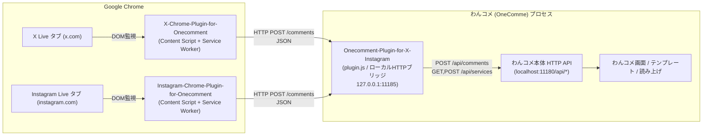

# X & Instagram Live コメント連携システム for わんコメ（OneComme）

**X Live（旧Twitter）** および **Instagram Live** の配信コメントを Google Chrome 上でリアルタイムに取得し、配信向けコメントビューア **[わんコメ（OneComme）](https://onecomme.com/)** へ統合表示・読み上げ連携させるためのツールセットです。

---

## 概要・目的

X Live や Instagram Live には一般向けの公式ライブチャット取得 API が提供されていないため、通常は他の配信プラットフォームのようにコメントビューアへコメントを統合することが困難です。

本プロジェクトは、ブラウザ上で表示されるライブ配信のコメント欄を Chrome 拡張機能でリアルタイムに監視・取得し、専用のわんコメプラグイン経由でわんコメ本体へ連携することで、以下を実現することを目的としています。

- **マルチプラットフォーム配信のコメント一元管理**: X Live・Instagram Live のコメントをわんコメ上にまとめて表示
- **配信画面テンプレート・読み上げ連携**: わんコメのテンプレート機能（OBS 等での表示）や読み上げ機能へそのまま反映
- **簡単な導入と安全なローカル連携**: わんコメプラグインがローカル専用のブリッジサーバーとして動作するため、煩雑な CORS 設定や外部 npm パッケージのインストールなしで導入可能

---

## 主な特徴

- **3つの独立したコンポーネント構成**: X用・Instagram用・わんコメプラグインが独立しており、必要なプラットフォームのみを導入・更新可能
- **外部依存ゼロ（わんコメプラグイン）**: Node.js 標準モジュールのみで動作するため、フォルダをコピーするだけで利用可能
- **プラットフォーム別の自動枠分離**: X 用（デフォルト: `X Live コメント`）と Instagram 用（デフォルト: `Instagram Live コメント`）で自動的に別々の枠へ振り分け（枠の自動作成 / 既存枠の選択に対応）
- **実用的なフィルタリング・制御機能**:
  - 監視開始時にすでに表示されている過去コメントのスキップ（設定変更可）
  - 重複コメントの自動排除
  - Instagram Live の「〇〇さんが参加しました」「手を振りました」などのシステム通知を除外（設定変更可）
  - 絵文字（``）のテキスト復元
- **UI 変更への耐性**: 各サービスの DOM 仕様変更時にも、拡張機能の詳細設定画面からカスタム CSS セレクタを上書きして対処可能
- **プライバシー・セキュリティ配慮**: 取得したコメントデータはローカル PC 内（`127.0.0.1`）でのみやり取りし、外部サーバーへは一切送信しません（任意の共有トークン認証にも対応）

---

## システム構成

本リポジトリは以下の 3 つのディレクトリ（プログラム）で構成されています。

| ディレクトリ名 | 種別 | 役割 | 個別ドキュメント |
| :--- | :--- | :--- | :--- |
| `Onecomment-Plugin-for-X-Instagram` | わんコメプラグイン (Node.js / CommonJS) | 2つの Chrome 拡張機能からコメントを受信・正規化し、わんコメ本体へ投入する | [README](./Onecomment-Plugin-for-X-Instagram/README.md) |
| `X-Chrome-Plugin-for-Onecomment` | Chrome 拡張機能 (Manifest V3) | X Live の配信チャットを取得し、わんコメプラグインへ送信する | [README](./X-Chrome-Plugin-for-Onecomment/README.md) |
| `Instagram-Chrome-Plugin-for-Onecomment` | Chrome 拡張機能 (Manifest V3) | Instagram Live の配信コメントを取得し、わんコメプラグインへ送信する | [README](./Instagram-Chrome-Plugin-for-Onecomment/README.md) |

### アーキテクチャ図



---

## 動作環境・前提条件

- **OS**: Windows（わんコメのプラグイン配置パスは Windows 環境を前提としています）
- **わんコメ（OneComme）**: インストール済みであること（本体 API ポートは標準 `11180`、設定で変更可）
- **ブラウザ**: Google Chrome（Manifest V3 対応バージョン）

---

## インストール方法

まず、本リポジトリを PC にダウンロードしてください（GitHub の `Code` → `Download ZIP` で展開するか、`git clone` を実行します）。

その後、以下の **Step 1 → Step 2 / Step 3** の順で導入します（X と Instagram は使用する方だけの導入でも動作します）。

### Step 1: わんコメプラグインの導入 (`Onecomment-Plugin-for-X-Instagram`)

1. `Onecomment-Plugin-for-X-Instagram` フォルダを丸ごと、わんコメのプラグインフォルダ配下にコピーします。
   ```text
   %APPDATA%\onecomme\plugins\Onecomment-Plugin-for-X-Instagram\
   ```
   ※ 通常は `C:\Users\<ユーザー名>\AppData\Roaming\onecomme\plugins\Onecomment-Plugin-for-X-Instagram\` です。
2. わんコメを起動し、右上のメニューから **「プラグイン」** 画面を開きます。
3. **「再読み込み」** をクリックし、**「X & Instagram Live コメント連携プラグイン」** を **有効（ON）** にします。
4. 有効化すると、ローカルブリッジサーバー（デフォルト: `http://127.0.0.1:11185`）が自動的に起動します。

> **疎通確認（任意）**: ブラウザまたはターミナルで `http://127.0.0.1:11185/health` にアクセスし、`"status": "ok"` を含む JSON が返ってくれば正常に稼働しています。

### Step 2: X 用 Chrome 拡張機能の導入 (`X-Chrome-Plugin-for-Onecomment`)

1. Google Chrome のアドレスバーに `chrome://extensions/` と入力して開きます。
2. 画面右上の **「デベロッパー モード」** を **ON** にします。
3. **「パッケージ化されていない拡張機能を読み込む」** をクリックし、`X-Chrome-Plugin-for-Onecomment` フォルダを選択します。
4. 拡張機能をツールバーにピン留めし、アイコンをクリックしてわんコメプラグインとの接続状態が **「接続OK」** になっていることを確認します。

### Step 3: Instagram 用 Chrome 拡張機能の導入 (`Instagram-Chrome-Plugin-for-Onecomment`)

1. Google Chrome で `chrome://extensions/` を開きます（「デベロッパー モード」が ON の状態）。
2. **「パッケージ化されていない拡張機能を読み込む」** をクリックし、`Instagram-Chrome-Plugin-for-Onecomment` フォルダを選択します。
3. 拡張機能をツールバーにピン留めし、アイコンをクリックしてわんコメプラグインとの接続状態が **「接続OK」** になっていることを確認します。

---

## 使い方

### X Live のコメントを読み込む

1. わんコメを起動した状態で、Google Chrome で X Live の配信ページ（例: `https://x.com/i/broadcasts/...` またはライブチャットが表示されているポスト）を開きます。
2. `X Live Comment Bridge for OneComme` のポップアップを開き、スイッチが **ON** かつ状態が **「チャット監視中」** であることを確認します。
3. 新規に投稿されたコメントが、わんコメの **`X Live コメント`** 枠へ自動的に反映されます（初回送信時に枠が存在しない場合は自動作成されます）。

### Instagram Live のコメントを読み込む

1. わんコメを起動した状態で、Google Chrome で Instagram Live の配信ページ（例: `https://www.instagram.com/<ユーザー名>/live/`）を開きます。
2. `Instagram Live Comment Bridge for OneComme` のポップアップを開き、スイッチが **ON** かつ状態が **「ライブ監視中」** であることを確認します。
3. 新規に投稿されたコメントが、わんコメの **`Instagram Live コメント`** 枠へ自動的に反映されます（初回送信時に枠が存在しない場合は自動作成されます）。

### 主な設定項目（各拡張機能のポップアップ / 詳細設定画面）

- **ポップアップ画面**:
  - 取得の ON / OFF 切り替え（アイコンに状態バッジ表示）
  - わんコメプラグインとの接続ステータス確認
  - セッション送信件数・直近コメントのプレビュー表示
  - **テストコメント送信ボタン**（配信外での動作確認に便利です）
- **詳細設定画面（オプション）**:
  - ブリッジ接続先 URL（デフォルト: `http://127.0.0.1:11185`）
  - 共有トークン（任意）
  - 送信先のわんコメ枠 ID の選択（自動 または 既存枠を指定）
  - 初期ロード時の既存コメントスキップ ON / OFF
  - システムメッセージ除外 ON / OFF（Instagram 用）
  - カスタム CSS セレクタの上書き設定（プラットフォーム側の UI 変更時の応急対応用）

---

## セキュリティ・注意事項・免責事項

- **ローカル通信限定**: わんコメプラグインのブリッジサーバーは `127.0.0.1` にのみバインドされ、外部ネットワークからはアクセスできません。また、CORS 制御により `chrome-extension://` オリジンからの通信のみを許可します。
- **非公式ツールについて**: 本プロジェクトは非公式の連携ツールであり、X Corp.、Meta Platforms, Inc.、およびわんコメ（OneComme）開発元とは一切関係ありません。
- **サービス仕様変更による影響**: X・Instagram の Web 画面（DOM 構造）を監視してコメントを取得する方式のため、両サービスのアップデートにより正常に取得できなくなる場合があります。その際は拡張機能の詳細設定にあるカスタム CSS セレクタでの調整、または各 `selectors.js` の更新を行ってください。
- **免責事項**: 各プラットフォームの利用規約を遵守のうえ、自己責任でご利用ください。本ツールの使用により生じたいかなる損害についても、作者は一切の責任を負いません。

---

## 詳細仕様書

通信プロトコルや内部設計の詳細は、リポジトリ内の仕様書をご参照ください。

- [XとInstagramのコメントをわんコメで読み込むシステム.md](./XとInstagramのコメントをわんコメで読み込むシステム.md)

---

## ライセンス

このプロジェクトは [MIT License](./LICENSE) のもとで公開されています。
著作権表示およびライセンス文を保持する限り、商用・非商用を問わず自由に利用・改変・再配布できます。

---

## 作者

- **作者**: ゲレの工房
- **Web サイト**: https://www.gelehrte.com/
- **Email**: ein.gelehrte@gmail.com
