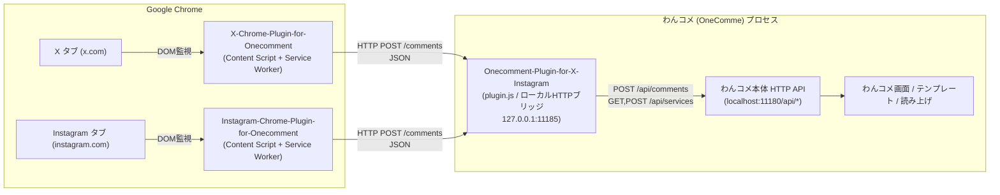

# XとInstagramのコメントをわんコメで読み込むシステム 仕様書

## 1. 概要

本システムは、**X（旧Twitter）** および **Instagram** のコメントをGoogle Chrome上でリアルタイムに取得し、配信向けコメントビューア **わんコメ（OneComme）** に統合表示・読み上げ連携させるためのシステムである。

利用環境ごとに独立してインストール・更新できるよう、役割に応じて以下の **3つの独立したプログラム（ディレクトリ）** に分割し、ローカル通信プロトコルを介して連動する構成とする。

| ディレクトリ名 | 種別 | 役割 |
| :--- | :--- | :--- |
| `X-Chrome-Plugin-for-Onecomment` | Chrome拡張機能 (Manifest V3) | X上のコメントを取得し、わんコメプラグインへ送信する |
| `Instagram-Chrome-Plugin-for-Onecomment` | Chrome拡張機能 (Manifest V3) | Instagram上のコメントを取得し、わんコメプラグインへ送信する |
| `Onecomment-Plugin-for-X-Instagram` | わんコメプラグイン (Node.js / CommonJS) | 2つのChrome拡張機能からコメントを受信・正規化し、わんコメ本体へ投入する |

---

## 2. システム全体アーキテクチャ

### 2.1 コンポーネント連携図



### 2.2 設計方針（なぜわんコメプラグインを仲介させるか）

Chrome拡張機能からわんコメ本体（`http://localhost:11180/api/comments`）へ直接送信せず、`Onecomment-Plugin-for-X-Instagram` を仲介させる理由は以下の通り。

1. **導入・CORS設定の簡略化**:
   アンパック導入したChrome拡張機能は環境ごとに拡張機能ID（`chrome-extension://<id>`）が変わるため、わんコメ本体のAPI許可オリジン設定を毎回手作業で行う必要がある。プラグイン側でローカル専用ブリッジサーバー（`127.0.0.1`）を提供し適切なCORS制御を行うことで、導入手順を大幅に簡素化する。
2. **プラットフォーム別の自動振り分けと枠管理**:
   X用・Instagram用のわんコメ枠（`service.id`）のマッピングや、存在しない場合の自動生成・一覧取得を一元管理できる。
3. **データ正規化・重複排除・フィルタの一元化**:
   複数タブの同時開放やページ再読み込みによる重複コメントの抑止、システムメッセージ除外、プロフィール画像フォールバック、プラットフォーム識別情報の付与を共通化できる。
4. **拡張性の確保**:
   将来的に別SNS用のChrome拡張を追加する場合も、同じ共通プロトコルに従えばわんコメプラグイン側をそのまま再利用できる。

---

## 3. 共通通信プロトコル仕様（拡張機能 ⇔ わんコメプラグイン）

2つのChrome拡張機能とわんコメプラグインは、以下のローカルHTTP JSON APIを介して連動する。

### 3.1 接続基本仕様

- **バインドアドレス**: `127.0.0.1`（ローカルマシン限定、外部ネットワーク非公開）
- **デフォルトポート**: `11185`（わんコメプラグイン設定および各Chrome拡張機能の設定画面で変更可能）
- **文字コード / 形式**: UTF-8 / `application/json`
- **任意認証ヘッダ**: `X-Bridge-Token: <設定された共有トークン>`（プラグイン側でトークンを設定した場合のみ必須。空文字の場合は認証スキップ）

### 3.2 エンドポイント一覧

#### 1) ヘルスチェック: `GET /health`
拡張機能側がわんコメプラグインの稼働状態・設定済み枠を確認するために使用する。

- **レスポンス例 (`200 OK`)**:
```json
{
  "status": "ok",
  "plugin": "Onecomment-Plugin-for-X-Instagram",
  "version": "1.0.0",
  "onecommeReachable": true,
  "mapping": {
    "x": { "serviceId": "uuid-for-x", "serviceName": "X コメント" },
    "instagram": { "serviceId": "uuid-for-ig", "serviceName": "Instagram コメント" }
  }
}
```

#### 2) わんコメ枠一覧取得: `GET /services`
わんコメ本体の `GET http://localhost:11180/api/services` を中継し、拡張機能の設定画面から送信先枠を選べるようにする。

- **レスポンス例 (`200 OK`)**:
```json
{
  "services": [
    { "id": "uuid-1", "name": "X コメント", "enabled": true },
    { "id": "uuid-2", "name": "Instagram コメント", "enabled": true }
  ]
}
```

#### 3) コメント送信: `POST /comments`
Chrome拡張機能が取得した新規コメントを単発または配列（バッチ）で送信する。

- **リクエストボディ**:
```json
{
  "platform": "x",
  "sourceType": "live",
  "sourceUrl": "https://x.com/i/broadcasts/1234567890",
  "serviceId": "",
  "comments": [
    {
      "id": "x_live_1732580000000_abcd1234",
      "userId": "sample_user",
      "name": "サンプルユーザー",
      "screenName": "@sample_user",
      "comment": "こんにちは！配信見てます！",
      "profileImage": "https://pbs.twimg.com/profile_images/...",
      "timestamp": 1732580000000,
      "isOwner": false,
      "isModerator": false,
      "hasGift": false,
      "isSystem": false,
      "badges": [
        {
          "url": "",
          "label": "X",
          "type": "platform"
        }
      ]
    }
  ]
}
```

- **主要フィールド定義**:

| フィールド | 型 | 必須 | 説明 |
| :--- | :--- | :---: | :--- |
| `platform` | `"x" \| "instagram"` | ○ | 送信元プラットフォーム |
| `sourceType` | `"live"` | ○ | 取得元種別（ライブ配信チャット固定 `"live"`） |
| `sourceUrl` | `string` | △ | 取得元ページのURL |
| `serviceId` | `string` | △ | 送信先のわんコメ枠IDを上書き指定したい場合に使用（省略時はプラグイン側設定を使用） |
| `comments` | `Array<CommentItem>` | ○ | 送信するコメント配列（最大50件/リクエスト） |
| `comments[].id` | `string` | ○ | プラットフォーム内で一意なコメントID（DOM固有IDまたは内容ベースハッシュ） |
| `comments[].userId` | `string` | ○ | ユーザー識別子（アカウントID / ハンドル等） |
| `comments[].name` | `string` | ○ | わんコメに表示するユーザー名 |
| `comments[].screenName` | `string` | △ | `@handle` 等のアカウント名（任意） |
| `comments[].comment` | `string` | ○ | コメント本文（プレーンテキストまたは絵文字含む文字列） |
| `comments[].profileImage` | `string` | △ | ユーザーアイコン画像URL（未取得時は空文字） |
| `comments[].timestamp` | `number` | △ | 投稿時刻のUNIXタイムスタンプ（ミリ秒）。未指定時はプラグイン受信時刻を補完 |
| `comments[].isOwner` | `boolean` | △ | 配信者本人のコメントか（デフォルト `false`） |
| `comments[].isModerator` | `boolean` | △ | モデレーターか（デフォルト `false`） |
| `comments[].hasGift` | `boolean` | △ | ギフト・投げ銭を伴うか（デフォルト `false`） |
| `comments[].isSystem` | `boolean` | △ | 「参加しました」等のシステム通知か（デフォルト `false`） |
| `comments[].badges` | `Array<Badge>` | △ | バッジ配列 `{ url, label, type }` |

- **レスポンス例 (`200 OK`)**:
```json
{
  "ok": true,
  "accepted": 1,
  "skippedDuplicate": 0,
  "skippedFiltered": 0,
  "failed": 0,
  "errors": []
}
```

#### 4) プラグイン設定取得・更新: `GET /config` / `POST /config`
各プラットフォームのデフォルト枠ID、システムメッセージ除外、デバッグログ出力などの設定を参照・変更する。

---

## 4. 各プログラム詳細仕様

### 4.1 `X-Chrome-Plugin-for-Onecomment`（X用 Chrome拡張機能）

#### 概要
X（`https://x.com/*`, `https://twitter.com/*`）のブラウザタブ上でDOM変化を監視し、新規コメントを抽出して `Onecomment-Plugin-for-X-Instagram` へ送信する Manifest V3 拡張機能。

#### 対象ページ・動作モード
- **X Live（ブロードキャスト配信チャット）専用**
  - 対象URL例: `https://x.com/i/broadcasts/*`, `https://x.com/*/status/*`（ライブプレイヤー併設チャット表示時）, `https://twitter.com/i/broadcasts/*`
  - チャット欄コンテナを `MutationObserver` で監視し、追加されたチャットアイテムからユーザー名・アイコン・本文・配信者バッジ等を抽出する。
  - 初回ページ読み込み時に表示済みの過去コメントを一斉送信しないよう、**「監視開始時点の既存要素を既読登録してから新規要素のみ送信」** する制御を行う（設定で変更可能）。

#### 主な機能
- **DOM監視とフォールバックセレクタ**:
  - XはDOMクラス名が頻繁に変更されるため、`data-testid` や `role`、構造ベース（ARIA属性・相対階層）の複数セレクタ候補を優先順位付きで試行する設計とする。
  - 設定画面からカスタムCSSセレクタを上書きできるデバッグ/保守オプションを用意する。
- **重複排除**:
  - チャット要素固有ID、取得できない場合は `userId + comment + 近傍時刻バケット` のハッシュを生成し、拡張機能内のリングバッファ（直近1,000件）で重複送信を防ぐ。
- **絵文字・メンション処理**:
  - `` 形式で描画される絵文字を `alt` 属性テキストへ復元して本文を組み立てる。
- **Service Worker 経由送信とリトライ**:
  - Content Script から `chrome.runtime.sendMessage` で Background Service Worker へ渡し、Service Worker から `http://127.0.0.1:11185/comments` へ `fetch` 送信する（ページ側のCSPやMixed Content制限を回避するため）。
  - 一時的な通信失敗時は短時間キューイング＆指数バックオフで再送し、わんコメ未起動時はエラー状態をバッジ表示する。
- **Popup UI**:
  - 取得の ON / OFF トグル（拡張機能アイコンに状態バッジ表示：`ON` / `OFF` / `ERR`）
  - わんコメプラグイン接続ステータス表示（`GET /health` 結果）
  - 送信先のわんコメ枠（X用）の表示
  - セッション送信件数・直近送信コメントのプレビュー（最新5件）
  - テストコメント送信ボタン
- **Options UI（詳細設定）**:
  - ブリッジ接続先URL（デフォルト `http://127.0.0.1:11185`）
  - 共有トークン（任意）
  - 送信先のわんコメ枠ID指定（`GET /services` からプルダウン選択、または自動＝プラグイン側のX用枠）
  - 表示名フォーマット（表示名のみ / `@handle` 併記）
  - 初期ロード時の既存コメントをスキップするか（デフォルト ON）
  - カスタムCSSセレクタ上書き（コンテナ / メッセージ行 / ユーザー名 / 本文）
  - バッチまとめ時間（デフォルト 300ms）

#### 想定フォルダ構成
```text
X-Chrome-Plugin-for-Onecomment/
├─ manifest.json          # Manifest V3 定義
├─ background.js          # Service Worker（HTTP送信・接続監視・バッジ管理）
├─ content.js             # XページDOM監視・コメント抽出
├─ selectors.js           # X用DOMセレクタ定義・抽出ヘルパー
├─ popup.html             # ポップアップUI
├─ popup.js               # ポップアップ制御
├─ popup.css              # スタイル
├─ options.html           # 詳細設定画面
├─ options.js             # 設定の保存・読み込み (chrome.storage.local)
├─ icons/                 # 拡張機能アイコン (16/48/128px)
└─ README.md              # 個別インストール・利用手順
```

#### 必要な権限 (`manifest.json`)
- `permissions`: `["storage", "tabs"]`
- `host_permissions`: `["https://x.com/*", "https://twitter.com/*", "http://127.0.0.1/*", "http://localhost/*"]`

---

### 4.2 `Instagram-Chrome-Plugin-for-Onecomment`（Instagram用 Chrome拡張機能）

#### 概要
Instagram（`https://www.instagram.com/*`）のブラウザタブ上でライブ配信コメント（およびオプションで投稿コメント）のDOM変化を監視し、新規コメントを抽出して `Onecomment-Plugin-for-X-Instagram` へ送信する Manifest V3 拡張機能。

#### 対象ページ・動作モード
- **Instagram Live（ライブ配信コメント）専用**
  - 対象URL例: `https://www.instagram.com/*/live*`, `https://www.instagram.com/live/*`
  - ライブコメントリスト領域を `MutationObserver` で監視し、追加されたコメント行からユーザーID（ユーザー名）・プロフィール画像URL・コメント本文・認証/配信者バッジを抽出する。

#### 主な機能
- **システムメッセージ判定・除外**:
  - Instagram Liveでは「〇〇さんが参加しました」「〇〇さんが手を振りました」「〇〇さんがリクエストしました」等のシステム行がコメント欄に混在する。
  - パターンマッチ（日本語・英語双方の定型文およびDOM構造差異）により `isSystem: true` を判定し、デフォルトでは送信除外（設定で「システム通知も読み込む」へ切替可能）とする。
- **DOM監視と仮想スクロール対策**:
  - Instagramはライブ中に古いコメントDOMが破棄・再利用されることがあるため、`userId + normalizedComment` と受信タイムスタンプ（例：直近30秒以内の同一ユーザー同一本文の扱い）を組み合わせた堅牢な重複排除ロジックを持つ。
  - 初期接続時にすでに表示されている過去コメントは既読登録し、監視開始後の新規コメントのみを送信する（設定変更可）。
- **DOM変更耐性**:
  - 難読化クラス名への依存を極力避け、ユーザープロフィールリンク（`<a href="/<username>/">`）、アバター画像（`` 等）、コメントコンテナの相対DOM構造から抽出するフォールバック戦略を採用する。
- **Service Worker 経由送信・Popup UI・Options UI**:
  - `X-Chrome-Plugin-for-Onecomment` と統一感のあるUI/UXを提供する。
  - 固有設定項目として「参加通知などのシステムメッセージを除外する（デフォルト ON）」を持つ。

#### 想定フォルダ構成
```text
Instagram-Chrome-Plugin-for-Onecomment/
├─ manifest.json          # Manifest V3 定義
├─ background.js          # Service Worker（HTTP送信・接続監視・バッジ管理）
├─ content.js             # InstagramページDOM監視・コメント抽出
├─ selectors.js           # Instagram用DOMセレクタ定義・抽出・システム行判定
├─ popup.html             # ポップアップUI
├─ popup.js               # ポップアップ制御
├─ popup.css              # スタイル
├─ options.html           # 詳細設定画面
├─ options.js             # 設定の保存・読み込み (chrome.storage.local)
├─ icons/                 # 拡張機能アイコン (16/48/128px)
└─ README.md              # 個別インストール・利用手順
```

#### 必要な権限 (`manifest.json`)
- `permissions`: `["storage", "tabs"]`
- `host_permissions`: `["https://www.instagram.com/*", "http://127.0.0.1/*", "http://localhost/*"]`

---

### 4.3 `Onecomment-Plugin-for-X-Instagram`（わんコメ プラグイン）

#### 概要
わんコメ本体に読み込まれる Node.js（CommonJS）プラグイン。Chrome拡張機能2種からのコメントを受信し、わんコメ本体のHTTP API（`http://localhost:11180/api/comments` および `/api/services`）を用いてコメント一覧・配信テンプレート・読み上げ機能へ反映させる。

#### わんコメプラグイン基本仕様
- **配置先（Windows標準）**:
  `%APPDATA%\onecomme\plugins\Onecomment-Plugin-for-X-Instagram\`
- **メインファイル**: `plugin.js`
- **メタデータ**:
  - `name`: `'X & Instagram コメント連携プラグイン'`
  - `uid`: `'com.custom.onecomment-x-instagram'`
  - `version`: `'1.0.0'`
  - `permissions`: `['comments']`
- **ライフサイクルメソッド**:
  - `init({ dir, store }, initialData)`:
    - `store`（`electron-store`）から設定を読み込む（未設定時はデフォルト値を初期化）。
    - Node.js標準の `http` モジュールのみでローカルブリッジサーバー（`127.0.0.1:<port>`、デフォルト `11185`）を起動する（**外部npm依存ゼロ**でフォルダコピーだけで動く設計を基本とする）。
  - `request(req)`:
    - わんコメ内蔵プラグインREST API（`http://localhost:11180/api/plugins/com.custom.onecomment-x-instagram`）経由でも設定取得・更新・ステータス確認ができるよう対応する。
  - `destroy()`:
    - ローカルHTTPサーバーを安全に `server.close()` し、保持しているタイマーやリソースを解放する（再読み込み時の `EADDRINUSE` を防止）。

#### わんコメ本体APIとの連携仕様
1. **送信先枠（`service.id`）の解決ロジック**:
   - 優先順位1: 拡張機能からのリクエストに含まれる `serviceId`
   - 優先順位2: プラグイン設定に保存されたプラットフォーム別 `serviceId`（`xServiceId` / `instagramServiceId`）
   - 優先順位3: `GET http://localhost:11180/api/services` で既存枠を検索し、設定した枠名（デフォルト: `"X コメント"` / `"Instagram コメント"`）に一致する枠を使用
   - 優先順位4: 一致する枠が存在せず `autoCreateService: true` の場合、`POST http://localhost:11180/api/services` で外部コメント枠を自動作成し、その `id` を `store` に保存して利用する。
2. **コメント投入（`POST http://localhost:11180/api/comments`）**:
   受信した共通フォーマットを以下のわんコメAPI形式へ変換して送信する。

```json
{
  "service": {
    "id": "<解決されたservice.id>"
  },
  "comment": {
    "id": "x_live_1732580000000_abcd1234",
    "userId": "x:sample_user",
    "liveId": "x-live",
    "name": "サンプルユーザー",
    "displayName": "サンプルユーザー",
    "comment": "こんにちは！配信見てます！",
    "profileImage": "https://pbs.twimg.com/profile_images/...",
    "originalProfileImage": "https://pbs.twimg.com/profile_images/...",
    "isOwner": false,
    "hasGift": false,
    "timestamp": 1732580000000,
    "badges": []
  }
}
```

#### 安全制御・品質機能
- **重複排除キャッシュ**: 受信済みコメントIDをメモリ内LRU/TTLキャッシュ（例: 最大2,000件 / TTL 10分）で管理し、二重投入を防ぐ。
- **サニタイズ・文字数制限**: 制御文字の除去、極端に長い本文の切り詰め（設定可能、デフォルト500文字）、HTMLエスケープ方針の統一。
- **レート制御・キュー処理**: コメントが短時間に大量流入してもわんコメ本体APIを詰まらせないよう、逐次送信キュー（同時実行数制限）を設ける。
- **エラーログ**: わんコメのプラグインログ（`plugin.log` / `main.log`）へ分かりやすく `[X-IG-Bridge]` プレフィックス付きでログ出力する。

#### 想定フォルダ構成
```text
Onecomment-Plugin-for-X-Instagram/
├─ plugin.js              # わんコメプラグイン本体（エントリポイント）
├─ lib/
│  ├─ server.js           # ローカルHTTPブリッジサーバー (Node.js標準 http)
│  ├─ onecommeClient.js   # わんコメ本体APIクライアント (/api/services, /api/comments)
│  ├─ normalizer.js       # コメント正規化・重複排除・サニタイズ
│  └─ config.js           # デフォルト設定・バリデーション
└─ README.md              # わんコメへのインストール・設定手順
```

---

## 5. セキュリティ・制約事項

1. **ローカル通信限定**:
   - ブリッジサーバーは必ず `127.0.0.1` にのみバインドし、LANやインターネットからのアクセスを受け付けない。
2. **CORS制限**:
   - レスポンスの `Access-Control-Allow-Origin` は `chrome-extension://` オリジン（および設定された許可オリジン）のみ許可し、任意のWebサイトからの無断コメント送信（CSRF的悪用）を防ぐ。
   - オプションで `X-Bridge-Token` による共有シークレット認証を有効化できる。
3. **外部サービスの仕様変更リスク**:
   - X・Instagramはいずれも公式のライブチャット取得APIを一般向けに公開しておらず、ブラウザDOM監視方式を採用する。
   - 両サービスのUIアップデートによりDOM構造が変更された場合、各Chrome拡張機能の `selectors.js` を更新することで迅速に追従できるモジュール構造とする。
4. **利用規約・プライバシーへの配慮**:
   - 取得したコメントデータはローカルPC上のわんコメへの転送のみに使用し、外部サーバーへ送信・収集しない。

---

## 6. インストールおよび初期セットアップ手順（想定）

3つのプログラムはそれぞれ独立してインストールする。

### Step 1: わんコメプラグインの導入 (`Onecomment-Plugin-for-X-Instagram`)
1. `Onecomment-Plugin-for-X-Instagram` フォルダを丸ごと `%APPDATA%\onecomme\plugins\` 配下にコピーする。
2. わんコメを起動し、右上メニューから **「プラグイン」** を開く。
3. **「再読み込み」** をクリックし、`X & Instagram コメント連携プラグイン` を **有効化（ON）** にする。
4. 必要に応じて、わんコメ側で「X コメント」「Instagram コメント」用の外部枠を用意する（自動作成ONの場合は初回送信時に自動生成）。

### Step 2: X用 Chrome拡張の導入 (`X-Chrome-Plugin-for-Onecomment`)
1. Google Chrome で `chrome://extensions/` を開く。
2. 右上の **「デベロッパー モード」** をONにする。
3. **「パッケージ化されていない拡張機能を読み込む」** をクリックし、`X-Chrome-Plugin-for-Onecomment` フォルダを選択する。
4. 拡張アイコンをクリックし、わんコメプラグインとの接続状態が **接続OK** であることを確認する。

### Step 3: Instagram用 Chrome拡張の導入 (`Instagram-Chrome-Plugin-for-Onecomment`)
1. Google Chrome で `chrome://extensions/` を開く。
2. **「パッケージ化されていない拡張機能を読み込む」** をクリックし、`Instagram-Chrome-Plugin-for-Onecomment` フォルダを選択する。
3. 拡張アイコンをクリックし、わんコメプラグインとの接続状態が **接続OK** であることを確認する。

---

## 7. テスト・検証計画

| 区分 | 検証項目 | 期待結果 |
| :--- | :--- | :--- |
| プラグイン単体 | わんコメでの読み込み・有効化・無効化・再読み込み | エラーなく起動/停止し、再読み込み時にポート競合が起きないこと |
| プラグインAPI | `GET /health`, `GET /services`, `POST /comments` の疎通 | 正常なJSONが返り、テストコメントがわんコメ画面に表示されること |
| 重複排除 | 同一 `id` のコメントを連続送信 | 2回目以降が `skippedDuplicate` として除外されること |
| X拡張機能 | X Liveチャット / タイムライン上での新規コメント検知 | 初期表示分はスキップされ、新規コメントのみがわんコメへ届くこと |
| Instagram拡張機能 | Instagram Live上での新規コメント検知・参加通知除外 | 通常コメントのみがわんコメへ届き、参加通知は除外設定に従うこと |
| 異常系 | わんコメ未起動時・プラグイン無効時の拡張機能動作 | 拡張機能がクラッシュせず、UI上に未接続エラーが表示され、復旧後に再接続できること |

---

## 8. 確定要件

ユーザー確認済みの確定仕様は以下の通り。

1. **Xの取得対象**: X Live（配信チャット）のみ
2. **Instagramの取得対象**: Instagram Live のみ
3. **わんコメでの枠構成**: 「X用（デフォルト枠名: `X Live コメント`）」「Instagram用（デフォルト枠名: `Instagram Live コメント`）」で別々の枠に分ける
4. **わんコメのAPIポート番号**: 標準の `11180`（プラグイン設定で変更可能）
